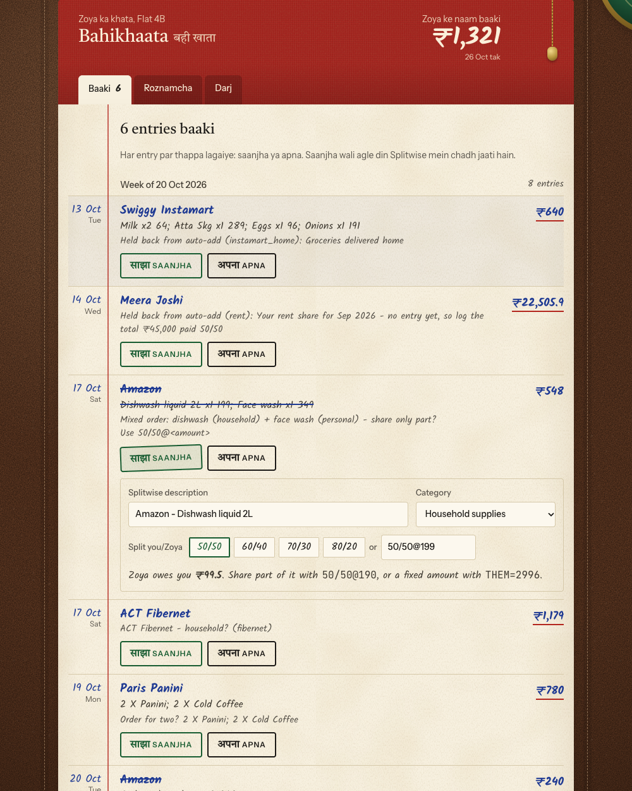
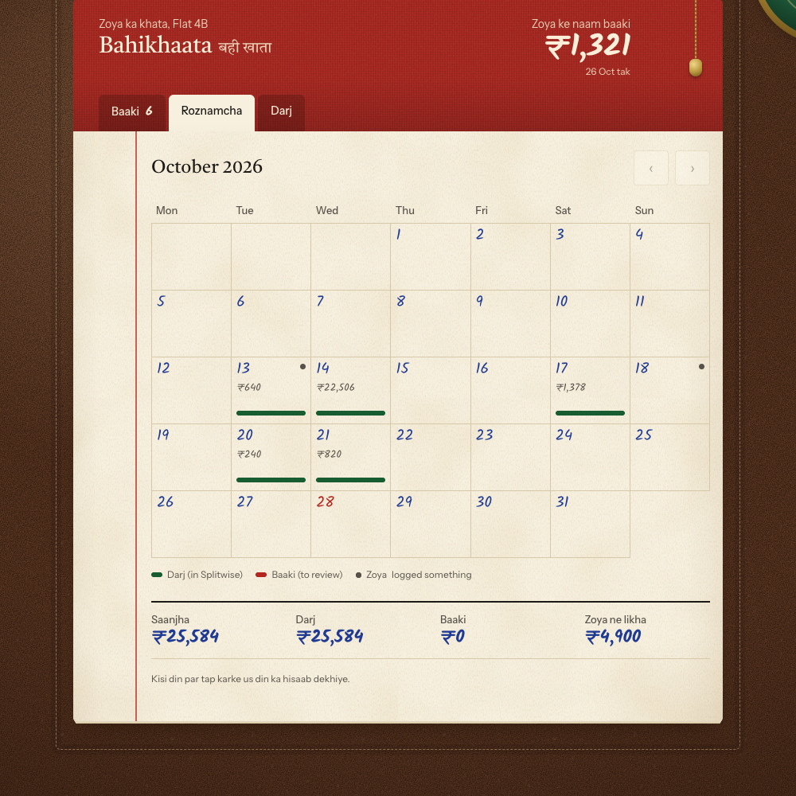
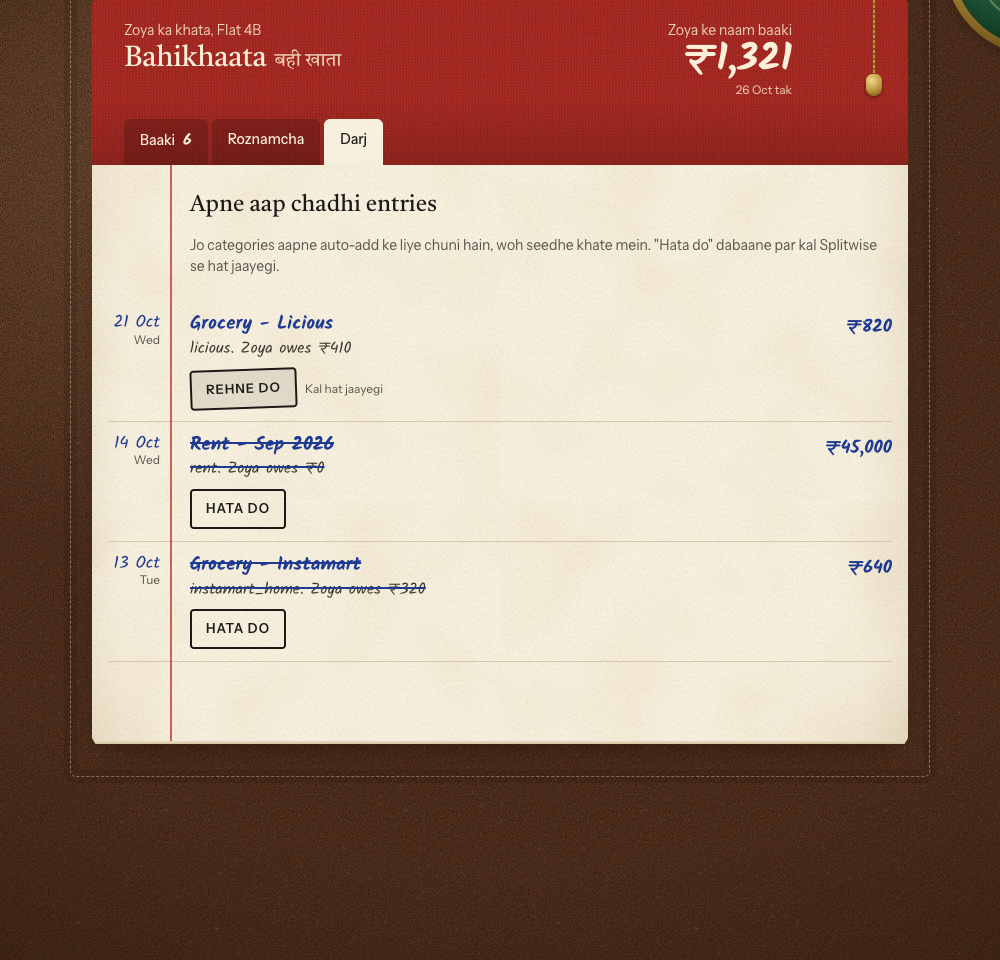

# Bahikhaata

**Your flat's shared expenses, found and logged in Splitwise for you.**

You and your flatmate split costs in Splitwise, but most shared spending never gets logged because nobody remembers to add it. Bahikhaata (बही-खाता, the old munim's ledger) fixes that. Claude reads your payments every morning, works out which ones you share, and queues them for you on a private page that looks like a bahi-khata register. You stamp each one साझा *Saanjha* (shared) or निजी *Apna* (mine), and the shared ones go into Splitwise.

**Nothing reaches Splitwise until you approve it**, except categories you choose to auto-add, such as groceries delivered home. Those show up on the page with an Undo.



<details><summary>More screenshots</summary>

**Roznamcha**, the calendar of what was shared each day:



**Darj**, what was auto-added, each with an undo:



</details>

*Screenshots use made-up data (Kabir, Zoya and Flat 4B from the dry run).*

## What you need

| | Why | Required? |
|---|---|---|
| [Claude Code](https://claude.com/claude-code) (desktop app) on a Mac | Runs everything, on your computer | Yes |
| A Splitwise account, with a group you share with your flatmate | Where approved expenses go | Yes |
| **Fold** with Fold Plus, *or* bank statement CSVs | Sees every payment you make | One of these |
| Gmail | Receipts (Swiggy, Instamart, Zomato, Amazon…) and card alerts, which show *what* a payment was for | Recommended |
| Swiggy / Instamart connectors | Delivery addresses, so it can tell what came home | Optional |

Zomato doesn't need a connector, because its order emails are enough. Python and git are needed too, and setup checks for them and tells you the one command to run if either is missing.

## Install (2 minutes)

Whoever shared Bahikhaata with you will send it as a zip or a private GitHub link. In Claude Code:

**From a zip:** unzip it anywhere, e.g. `~/Downloads/bahikhaata-skill`, then run:
```
/plugin marketplace add ~/Downloads/bahikhaata-skill
```
**From GitHub** (if you were given access):
```
/plugin marketplace add Aditya1001001/bahikhaata
```
Then install it:
```
/plugin install bahikhaata@bahikhaata
```
Restart Claude Code if it asks.

## Set up (about 15 minutes)

Open Claude Code in any folder and type:
```
/bahikhaata-setup
```
Claude asks you one thing at a time and does the technical work itself. If you stop halfway, run `/bahikhaata-setup` again and it picks up where you left off.

1. **Where to keep your files:** `~/Bahikhaata` is the default.
2. **Splitwise.** Claude installs a small Splitwise connector on your Mac. You register a free "app" at [secure.splitwise.com/apps](https://secure.splitwise.com/apps) (any name, Homepage `http://localhost`, Callback `http://localhost:8000/callback`). Claude then opens a file, and you paste your three keys into it. **Never paste keys into the chat**; they stay in that file on your Mac. Then you pick your flat's group and your flatmate from a list.
3. **Payment sources.** Claude offers one-click connections for Fold, Gmail, and optionally Swiggy and Instamart. All of them are used read-only. No Fold? You'll drop in a bank statement CSV each month instead.
4. **House rules.** Claude asks how your home address is saved in delivery apps, how you split by default, how rent works, and what's always shared or always yours. It reads the rules back for your OK.
5. **Your review page.** Claude makes your own private page. Only you can see it, so bookmark it.
6. **Auto-add (optional).** Pick categories that can go straight to Splitwise, such as Instamart delivered home or missing rent months, each with a cap. Everything starts off.
7. **First run.** Claude looks at the last week or two, nothing is added yet, and you stamp a few entries on the page. Claude then shows you exactly what it would add, and adds it only when you say yes.
8. **Daily run.** You pick a time (10am by default). Claude explains each permission it needs so the morning run doesn't keep asking.

Want to see it first? `/bahikhaata-setup dry-run` runs the whole flow on made-up data, without touching your Splitwise.

## Every week

- **Every morning** Claude quietly fetches yesterday's payments, auto-adds your chosen categories, and queues the rest.
- **Sunday** you get a notification ("6 auto-added, 9 to review"). Open your page, then:
  - **Baaki**: stamp each entry Saanjha or Apna. You can tweak the split: `50/50`, `70/30`, `50/50@190` (only ₹190 of it is shared) or `THEM=2996` (your flatmate owes a fixed amount). When you're done, press **Hisaab band karo**.
  - **Darj**: what was auto-added. Press **Wapas lo** to undo one.
  - **Roznamcha**: a calendar of what was shared each day, and what your flatmate logged.
- The next run adds what you stamped shared.

Useful commands: `/bahikhaata-run` (run now), `/bahikhaata-review` (what's waiting, and the balance). You can also just talk to it: *"gym stuff is always personal"*, *"stop auto-adding Licious"*, *"F7 is shared but 70/30"*.

## Privacy

- Your payment history lives only on your Mac, in `~/Bahikhaata/expense-log/`. It isn't uploaded anywhere, and the package has none of anyone's data.
- Your review page is a private artifact on your own Claude account. It shows only shared entries and your flatmate's Splitwise entries, never your total spending.
- Your Splitwise keys stay in `~/Bahikhaata/splitwise-mcp/.env`. The daily run is even blocked from reading that file.
- Connectors are used read-only. Claude never sends email, places orders or changes anything in Fold.

## What each source can and can't see

- **Fold / bank** sees every payment but not what it was for. Wallet top-ups (Amazon Pay, Swiggy Money) show up as one lump.
- **Zomato emails** have no delivery address, so "for two?" orders are always asked about.
- **Instamart** covers about the last 15 days; **Swiggy** the 15 most recent orders.
- **Amazon:** for item names on card charges, download your order history (Amazon, "Request your data") and save it as `~/Bahikhaata/expense-log/raw/amazon/Order History.csv`.
- **UPI Lite and cash** aren't in any source. Tell Claude about those.

## Tips

- **Tell your flatmate** before a backlog of entries lands in your group.
- Correct Claude whenever it's wrong. It remembers.
- Start small: the first run covers a week or two. Go further back once the rules feel right.

## Troubleshooting

Ask Claude *"Bahikhaata doctor"*. It checks everything without showing your keys.

| Problem | Fix |
|---|---|
| "No Splitwise keys yet" | Open `~/Bahikhaata/splitwise-mcp/.env`, paste the keys after the `=` signs, and save |
| Authentication error | Re-copy the keys with no spaces or quotes. If you ever pasted them in a chat, make new ones at secure.splitwise.com/apps |
| The morning run keeps asking for permission | Say *"refresh my Bahikhaata permissions"* |
| Something was added by mistake | Press **Wapas lo** on the page, or ask Claude to delete it. Splitwise can restore deleted expenses |
| You updated the plugin | Run `/bahikhaata-setup update` |
